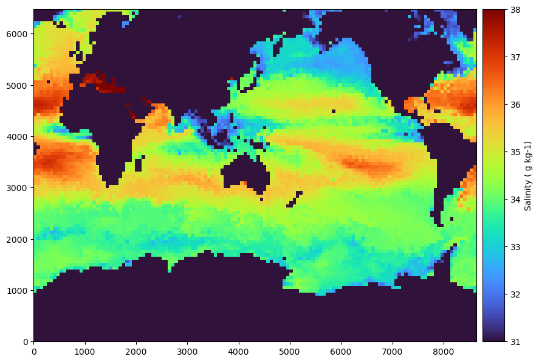
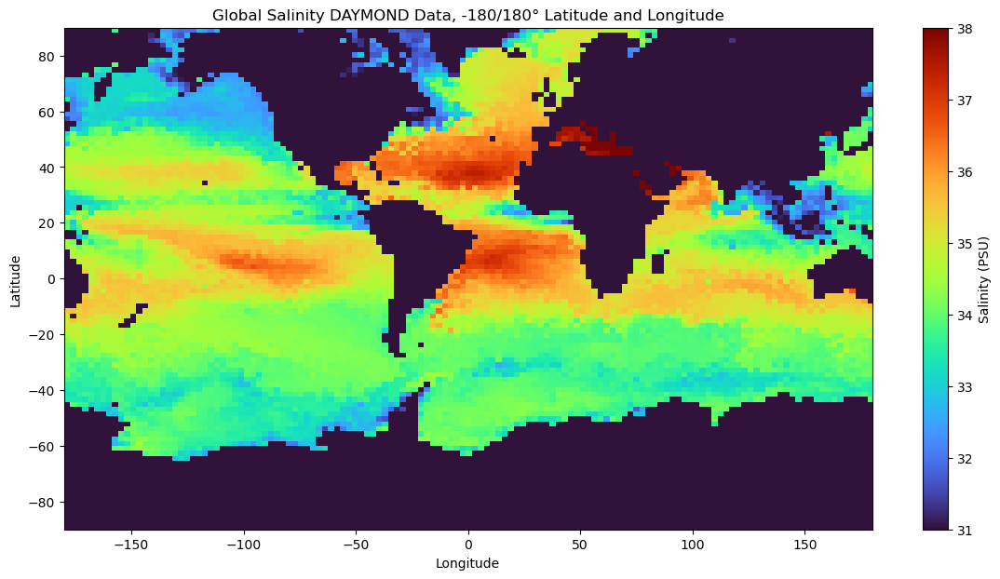
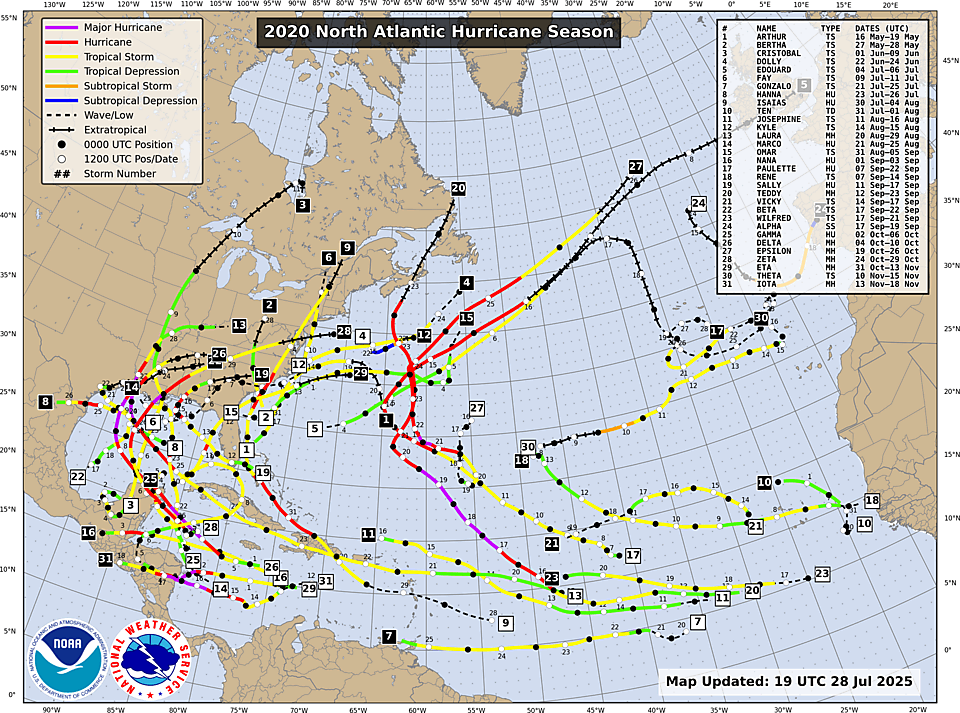
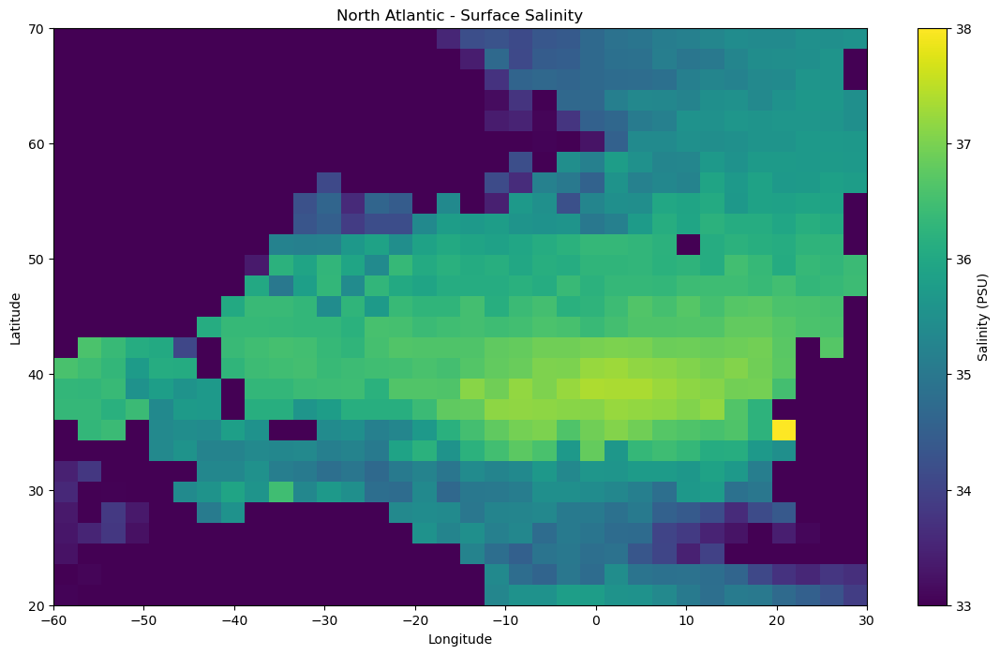
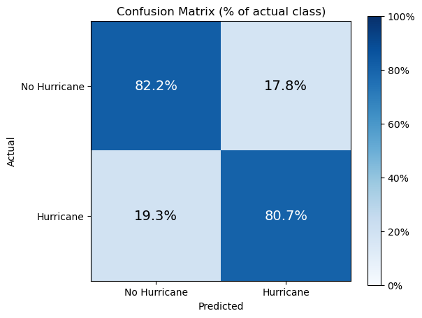
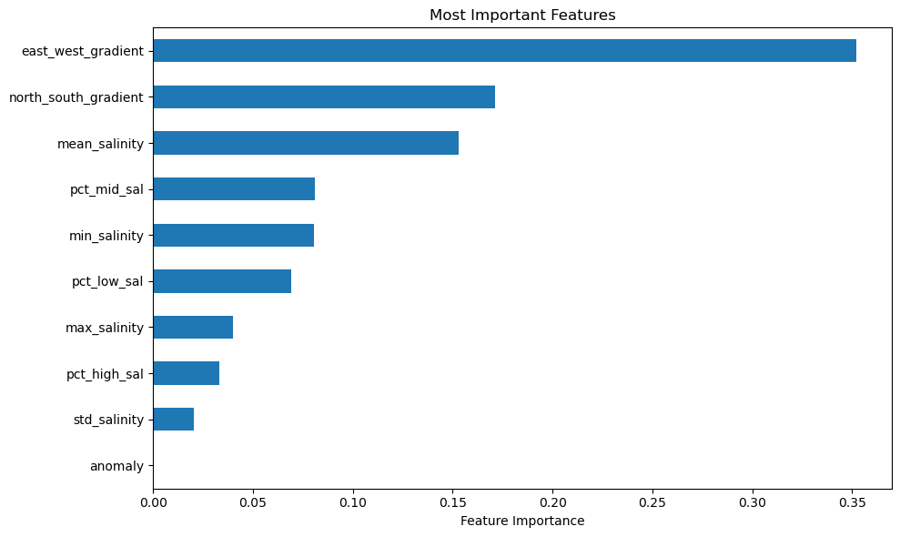

[](https://classroom.github.com/a/jfIvZbKc)
# COSC 526-426 Final Project: Leveraging Machine Learning Techniques to Predict Extreme Weather Events Using DYAMOND Data

## Navigating the Repository

### Table of Contents
- [Project Overview](#project-overview):       motivation, methods, and results of the project
- [Installation](#installation):               instructions for how to install a JetStream instance; what libraries are required in the conda environment
- [Set-Up](#set-up):                           how to run the notebook; expected output
- [Contact Information](#contact-information): number and email address in case of issues
- [Acknowledgements](#acknowledgements):       people and institutions who helped make this work possible
- [References](#references):                   academic citations

### File Directory
                             
| | File | Description |
|-|------|-------------|
| 📘 | project-code/hurricane.ipynb | contains the code for the project; execute to see results |
| 📘 | task2_weather_events/ieee_scivis_dyamond_ocean.ipynb | tutorial notebook to practice set-up |
| 🔶 | .gitignore | prevents unnecessary file pushes |
| 📊 | atlantic_salt_full.csv | previously read-in table with salinity data; enables fast runtime |
| 💲 | build_jetstream_environment.sh | used to create new JetStream enviornmnent |
| ❗️ | environment.yml | conda environment `nsdf-scivis` (package manager) |
| 🗂️ | images | graphics used in README|
| 🔺 | jetstream2_manual.pdf | instructions to create a JetStream2 instance |
| 🔑 | LICENSE | code license
| ℹ️ | README.md | you are here! instructions and information about the project

## Project Overview
This repository contains information for Alexa Andershock's final project for the the Spring 2026 COSC 426: Data Engineering class, taken in the Spring 2026 semester. This project leveraged the DYAMOND dataset and integrated machine learning techniques to predict the formation of hurricanes, cyclones, and tropic storms based on the 2020 North Atlantic hurricane data provided by the National Hurricane Center. Initial findings show that while the model successfully predicts 81% of hurricanes, only 53% of its total hurricane predictions are correct. A more detailed description of the project, as well as the contents of the repository, is detailed below.

### Motivation
Predicting the presence of a hurricane before landfall is paramount to creating hazard information, advising individual decisions, and saving lives. Machine learning techniques have been proven to extract trends from large datasets [[1, 2]](#1); therefore, this project utilized an XGBoosted model, which is ideal for large datasets and a small to medium number of parameters. We hope that these ML techniques can uncover trends that will predict the formation of hurricanes, cyclones, and tycoons before they make landfall and help residents and emergency service providers make more informed decisions. 

### Description
#### IEEE SciVis 2026 Contest
This project focused on exploring and visualizing large-scale climate datasets from the IEEE SciVis 2026 Contest. The contest provides real scientific data used in climate and ocean modeling, providing the opportunity to analyze complex environmental phenomena and communicate insights through visualization. This project focused on Task 2 from the SciVis contest tasks, which is described in detail on the [contest website](!https://sciviscontest2026.github.io/tasks/home). The proposed goal of this task was to study atmosphere–ocean interactions during storms and extreme weather events using the DYAMOND dataset [[3]](#3), which was implemented through machine learning techniques and external data from the 2020 North Atlantic hurrcane season [[4]](#4). A brief description of the methods can be found below.

### Methods
#### Data Filtering
This project consisted of a few steps to filter the data for efficiency and usefulness. </br>
1. <u> Shift data to center the Atlantic </u>
- The native data from the DYAMOND dataset bisected the Altantic ocean.
- So, the dataset was reconstructed to center the Atlantic and create a continuous dataframe.
- The new dataframe also removed salinity data from the land cells, giving them a value of *NA* instead of 31.

<table>
  <tr>
    <th>Before</th>
    <th>After</th>
  </tr>
  <tr>
    <td></td>
    <td></td>
  </tr>
</table>


2. <u> Apply latitude and longitude labels </u>
- Apply a sense of scale to the dataset to make it match with the National Hurricane Center data.
- Since the map was recentered around the Atalantic, the labels were not accurate to the global standard.

<table>
  <tr>
    <th>2020 North Atlantic Hurricane Season Data</th>
  </tr>
  <tr>
    <td></td>
  </tr>
</table>

3. <u> Constrict data to match 2020 North Atlantic </u>
- Narrow the data to the North Atlantic using visual inspection.
- This is the final dataset used in the project, which is visualized below.

<table>
  <tr>
    <th>Visualization of Final Dataset</th>
  </tr>
  <tr>
    <td></td>
  </tr>
</table>

#### Variables Added
Four engineered features were added to the dataset in order to train the model on more helpful salinity information, rather than just the position and salinity of the ocean cells. The variables were:
| Category | Variable | Description |
|------|------|-------------|
| Statistics        | mean, std, min, max    | The mean, standard deviation, minimum and maximum amount of salinity in the sample.      |
| Salinity Brackets | low, mid, high         | The percentage of ocean cells that have low, medium, and high percentages of salinity.   |
| Spatial Gradient  | north-south, east-west | The difference in salinity between the means of each half (north-south, east-west).      | 
| Anomaly           | anomaly                | The difference between the mean salinity and the global mean.                            | 

#### Machine Learning Integration
An XGBoosted [[5]](#5) tree model was used in this project. The final model was trained with 200 trees, a max tree depth of 6, a learning rate of 0.01, a scale positive rate of the ratio of the number of negative over positive labels, and an evaluation metric of area under the curve (AUC).

### Results
The final results of the model are shown below. The model performed relatively well, given the large class imbalance as seen in the Support column.
The total recall was about equal, meaning that the model was learning to discriminate between the classes effectively. It could accurately classify about 80% of both hurricane and non-hurricane events. The low precision in the Hurricane class, however, suggests that the model overly predicted the occurrence of a hurricane; as a result, it was only correct 53% of the time. </br>

| Class | Precision | Recall | F1-Score | Support | 
|-------------|------|------|------|------|
| No Hurricane | 0.94 | 0.82 | 0.88 | 3694|
| Hurricane    | 0.53 | 0.81 | 0.64 | 936 |

The feature that predicted the presence of a hurricane most strongly was the east-west salinity gradient. One explanation for this finding could be that since hurricanes typically travel from east to west, the large amount of rainfall in the east half would dilute the salinity of the water, causing the difference between the halves to rise.
</br>

<table>
  <tr>
    <th>Confusion Matrix</th>
    <th>Feature Importance</th>
  </tr>
  <tr>
    <td></td>
    <td></td>
  </tr>
</table>

### Future Work
Future work should focus on correcting data errors, including the latitudinal and longitudinal scaling and using all the 2020 hurricane data. Additional features, such as an indicator of hurricane season and other DYAMOND variables, should be added to the dataset. Storm classification should also be added. Finally, additional steps should be taken to counteract the class imbalance between the target labels.

## Installation
### Pre-Requisites
- Access to a Jetstream2 instance via SSH or WebShell
- *Optional (local machine only)*: Python v3.12.5 or higher
- *Optional (local machine only)*  Anaconda environment manager

### Dependencies
- Within the anacoda environment, the necessary libraries are listed within the `environment.yml` file.
- Additionally, even if these packages are not already downloaded into the conda environment, they will be installed in the notebook at runtime.
- Therefore, explicit installation of these external packages is not required by the user.

### Installing a JetStream Instance
Below are instructions of how to set up a JetStream2 instance with a NSDF-SciVis kernel. This will only need to be done once.

1. Initial Setup (skip if you already have an instance)
- If you do not already have a Jetstream2 instance, follow the instructions in the [Jetstream2 Setup Manual](./jetstream2_manual.pdf) to create and connect to one.

2. Connect to your Jetstream2 instance

3. Clone the project repository
    ```
    git clone https://github.com/CISC879-BigData/assignment10-soilmoisture-acandershock.git
    ```
4. Build the Python environment `Python (NSDF-SciVis)`
    ```
    module load miniforge
    ./build_jetstream_environment.sh
    ```
5. Start JupyterLab
    ```
    jupyter-ip.sh
    ```
6. Open JupyterLab
- Open the URL printed in the terminal in your web browser.
  
7. Select the correct kernel
- In JupyterLab, select the kernel named `Python (NSDF-SciVis)`.
  
8. Open the notebook
- Navigate to the Jupyter notebook titled `hurricane.ipynb` in the `project-code` repository. See further instructions in [Executing Notebook](#executing-notebook) for how to run.

### Installing New Python Libraries into the Environment
In case you would like to install new libraries into the enviroment that are not included in the `environment.yml` file, here is how you would do so.

1. Activate the SciVis environment
- From the terminal, run: 
    ```
    conda activate nsdf-scivis
    ```
2. Verify the Python path
- Confirm that your Python path points to the activated environment:
    ```
    which python
    ```
3. Install the desired library
- Replace `<library_name>` with the name of the library you want to install:
    ```
    python -m pip install <library_name>
    ```
4. Restart the Jupyter kernel 
- If you already have a JupyterLab session open, you may need to restart the kernel for the newly installed libraries to become available.

## Set-Up
### Running JetStream
*Note: you may skip this section if coming from Installation. These instructions assume you have a JetStream instance set up. If you do not, please refer to [Installing a JetStream Instance](#installing-a-jetstream-instance). </br>

1. Initial Set-Up (skip if you already have an instance)
- If you do not already have a Jetstream2 instance, follow the instructions in the [Jetstream2 Setup Manual](./jetstream2_manual.pdf) to create and connect to one.

2. Connect to your Jetstream2 instance
- This is section A4 in the [Jetstream2 Setup Manual](./jetstream2_manual.pdf), if you need a refresher on how to connect to the instance.

3. Navigate into the project directory.
    ```
    cd data-engineering-project-acandershock
    ```
4. Install tools
    ```
    module load miniforge
    ```
5. Start Jupyter Lab
    ```
    jupyter-ip.sh
    ```
6. Open JupyterLab
- Open the URL printed in the terminal in your web browser.
- In Visual Studio Code, you can also connect to Jupyter Labs using the ["Connect to a Remote Jupyter Server" instructions](https://code.visualstudio.com/docs/datascience/notebooks-web#_connect-to-a-remote-jupyter-server).

7. Select the correct kernel
- In JupyterLab, select the kernel named `Python (NSDF-SciVis)`.

8. Open the notebook
- Navigate to the Jupyter notebook titled `hurricane.ipynb` in the `project-code` repository. See further instructions in [Executing Notebook](#executing-notebook) for how to run.

### Executing Notebook
The notebook has two different ways to run, depending on the data you would like to use. This divergence occurs at Step 3. Please read the following section carefully to determine which path best applies to you when you arrive at that section.
The sections in the notebook have been categorized into RUN and CHOOSE, meaning:
- ALL: everyone must run these sections. Your notebook will not compile if you neglect them.
- CHOOSE: you must decide which section to run; you pick one or the other, but not both.

#### ALL: Initial Set-Up
| Order | Section Name | Description |
|-|---------------|-------------|
| 0 | Tutorial | pulls salinity (or salt) data from the DYAMOND website; demonstrates how to change the quality (or precision) of the data and the data type; demos how to save pictures and create visualizations | 
| 1 | Section 1a & 1b | prints the available variables (salt) and amount of data (10,365 hours); these can change if the user changes the data type or precision in the Tutorial | 
| 2 | Section 2: Focus on the North Atlantic | remaps the data to focus on the North Atlantic | 

#### CHOOSE: CSV or New Data
| Order | Section Name | Description |
|-|---------------|-------------|
| 3 | Section 3a: No CSV File | The `.csv` file that is provided has read in data for the 'salt' variable at precision `z=-18`, as set in the tutorial. If you are ok with using this variable and precision, execute this section. If you need to change either of these variables, the data will have to re-read from the cloud (see below). |
| 3 | Section 3b: CSV File | If you wish to make changes, the data must be re-downloaded from the cloud. Execute this section to do so. A time estimate is provided at the top of the cell (for `z=-18`, this was about an hour). |

#### ALL: Final Results
| Order | Section Name | Description |
|-|---------------|-------------|
| 4 | Section 4: Label Target Data | creates the four engineered labels and adds them to the dataframe | 
| 5 | Section 5: Train Model | splits the training data manually; imports and trains the XGBoosted model; prints results | 

## Contact Information

For any questions about the notebook, please contact Alexa "Lexy" Andershock at aandersh@vols.utk.edu or at (615) 801-2852.

## Acknowledgements
Thank you to Dr. Michela Taufer, Steven Dao, and the other GTAs who provided assistance in Spring 2026 for the COSC 426 Data Engineering course at the University of Tennessee, Knoxville.

## References
<a id="1">[1]</a>
J. Ge et al., “A comparison of a large language model vs manual chart
review for the extraction of data elements from the electronic health
record,” Gastroenterology, vol. 166, pp. 707–709.e3, 2023. </br>
<a id="2">[2]</a>
B. Khosravi et al., “Demystifying statistics and machine learning in
analysis of structured tabular data,” Journal of Arthroplasty, vol. 38,
no. 10, 2023. </br>
<a id="3">[3]</a>
B. Stevens et al., “Dyamond: the dynamics of the atmospheric general
circulation modeled on non-hydrostatic domains,” vol. 6, 2019. </br>
<a id="4">[4]</a>
National Hurricane Center, “2020 atlantic hurricane season.”
https://www.nhc.noaa.gov/data/tcr/index.php?basin=atlseason=2020,
2020. Accessed: 2026-05-12. </br>
<a id="5">[5]</a>
[5] T. Chen and C. Guestrin, “Xgboost: A scalable tree boosting system,”
Proceedings of the ACM SIGKDD Intern